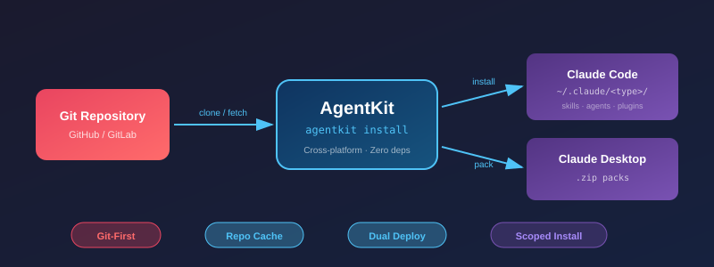

<div align="center">

# 🛠️ AgentKit

**Cross-platform CLI for managing Claude Code, Qwen Code and Claude Desktop artifacts**



[](https://www.python.org/)
[](https://opensource.org/licenses/MIT)
[](https://github.com/dtPaTh/agentkit)

[](https://github.com/dtPaTh/agentkit/stargazers)
[](https://github.com/dtPaTh/agentkit/network/members)

---

*One definition, multiple deployments* — Deploy `skills`, `commands`, `agents`, and `plugins` (artifacts) from a central Git repository to both Claude Code CLI and Claude Desktop App.

[Installation](#installation) •
[Usage](#usage) •
[Python API](#python-api) •
[Contributing](#development)

</div>

## 💡 Why AgentKit?

<table>
<tr>
<td width="33%" align="center">
<h3>🔗 Git-First</h3>
<p>Any Git repository can become an artifact source. Use official repos, fork your own, or host privately — full flexibility.</p>
</td>
<td width="33%" align="center">
<h3>🎯 Dual Environment</h3>
<p>One artifact definition, two targets. Deploy to <b>Claude Code CLI</b> and pack for <b>Claude Desktop</b> simultaneously.</p>
</td>
<td width="33%" align="center">
<h3>📍 Metadata Tracking</h3>
<p>Every installed artifact records its source repo, commit hash, and install time. Always know where your artifacts came from.</p>
</td>
</tr>
</table>

## ✨ Features

| Feature | Description |
|---------|-------------|
| 🖥️ **Cross-platform** | Windows, macOS, Linux |
| 📦 **Zero dependencies** | Uses only Python standard library |
| 🔗 **Flexible repo support** | GitHub, GitLab, self-hosted Git with subdirectory paths |
| 🏠 **Default repo** | Uses [Anthropic official skills](https://github.com/anthropics/skills) by default (overridable via env var) |
| 🧩 **Multi-artifact support** | Manages `skills`, `commands`, `agents`, and `plugins` |
| 🎯 **Selective installation** | Install all artifacts, pick specific ones by name, or choose interactively — to `global` (`~/.claude/`) or `local` (`.claude/`) scope |
| 🛡️ **Safety controls** | `--dry-run` preview, `--backup` before overwrite |
| 📍 **Source tracking** | Records installation source for each artifact |
| 🚀 **Dual deployment** | Claude Code (`~/.claude/<type>/`) + Claude Desktop (`.zip` packs) |
| 🔀 **Multi-agent targets** | Install for Claude Code (default) or Qwen Code (`--agent qwen`), converting conventions both ways with a change report |
| ⚡ **Repo cache** | Repos are cached locally and updated with `git fetch` on reuse |


## 🚀 Quick Start

```bash
# Install the CLI
pip install git+https://github.com/dtPaTh/agentkit.git

# List all artifacts from the default repo
agentkit list

# List only agents from a custom repo 
agentkit list https://github.com/your-org/your-repo --type agents

# Install a specific agent to global Claude config
agentkit install https://github.com/your-org/your-repo --type agents --items my-agent

# Install to the current project instead
agentkit install https://github.com/your-org/your-repo --type agents --items my-agent --scope local
```

## 📥 Installation

### macOS / Linux

```bash
curl -fsSL https://raw.githubusercontent.com/dtPaTh/agentkit/main/install.sh | bash
```

### Windows PowerShell

```powershell
irm https://raw.githubusercontent.com/dtPaTh/agentkit/main/install.ps1 | iex
```

### From Source (pip
```bash
git clone https://github.com/dtPaTh/agentkit.git
cd agentkit
pip install -e .
```

## 📖 Usage

### kubectl-style Syntax

AgentKit supports a shorthand notation inspired by `kubectl` where the **resource type** and **repository URL** can be passed as positional arguments — no flags needed.

```
agentkit <command> [<type>] [<url>]
```

| Long form | kubectl-style shorthand |
|-----------|------------------------|
| `agentkit list --type agents` | `agentkit list agents` |
| `agentkit list --type skills --repo <url>` | `agentkit list skills <url>` |
| `agentkit list --repo <url>` | `agentkit list <url>` |
| `agentkit install --repo <url> --type agents` | `agentkit install agents <url>` |

The positional parser distinguishes a URL from a type token: if the argument starts with `http`, `git@`, or contains `/`, it is treated as a repository URL; otherwise it is treated as an artifact type (`skills`, `agents`, `commands`, `plugins`).

---

### Getting Help

```bash
agentkit --help
agentkit list --help
agentkit install --help
```

---

### List Available Artifacts

`list` shows **all artifact types** by default. Pass a type and/or URL as positional arguments (kubectl-style) or use flags.

```bash
# List all types from the default repo
agentkit list

# List only agents — three equivalent forms
agentkit agents list                             # <type> <verb>
agentkit list agents                             # <verb> <type>
agentkit list --type agents                      # flag form

# List skills from a custom repo — three equivalent forms
agentkit skills list https://github.com/your-org/your-repo
agentkit list skills https://github.com/your-org/your-repo
agentkit list https://github.com/your-org/your-repo --type skills

# List all types from a custom repo
agentkit list https://github.com/your-org/your-repo

# Show names and descriptions
agentkit list --detail

# Force a fresh clone, ignoring the local cache
agentkit list --no-cache
```

---

### Install Artifacts

```bash
# Interactive selection from the default repo
agentkit install

# Install all artifacts from the default repo to global config
agentkit install --all

# Install a specific agent — three equivalent forms
agentkit agents install --items my-agent
agentkit install agents --items my-agent
agentkit install --type agents --items my-agent

# Install all plugins from a custom repo — three equivalent forms
agentkit plugins install https://github.com/your-org/your-repo --all --scope global
agentkit install plugins https://github.com/your-org/your-repo --all --scope global
agentkit install https://github.com/your-org/your-repo --type plugins --all --scope global

# Install to the current project's .claude/ directory
agentkit plugins install https://github.com/your-org/your-repo --all --scope local

# Preview without making changes
agentkit install --all --dry-run

# Overwrite existing artifacts with backup
agentkit install --all --force --backup

# Force fresh clone instead of using cache
agentkit install --all --no-cache
```

---

### Remove Artifacts

```bash
# Interactive selection
agentkit remove

# Remove specific artifacts
agentkit remove --items my-skill,another-skill

# Remove all agents — three equivalent forms
agentkit agents remove --all
agentkit remove agents --all
agentkit remove --type agents --all

# Remove from project config instead of global
agentkit skills remove --all --scope local

# Preview what would be removed
agentkit remove --all --dry-run

# Skip confirmation prompt
agentkit remove --all --force
```

---

### List Installed Artifacts

```bash
# Show all installed artifacts (global + project)
agentkit installed

# Show with source tracking info
agentkit installed --detail

# Show only project-local artifacts
agentkit installed --project

# Filter by type — three equivalent forms
agentkit agents installed
agentkit installed agents
agentkit installed --type agents
```

---

### Update Artifacts

`update` refreshes already-installed artifacts from their original source. It reads the `.agentkit.json` metadata written at install time to find the upstream URL — no need to remember where each artifact came from.

```bash
# Interactive selection from installed artifacts
agentkit update

# Update all installed skills
agentkit update --all

# Update specific artifacts by name
agentkit update --items my-skill,other-skill

# Update all installed agents — three equivalent forms
agentkit agents update --all
agentkit update agents --all
agentkit update --type agents --all

# Update project-local artifacts
agentkit update --all --scope local

# Backup before overwriting
agentkit update --all --backup

# Preview what would be updated without changing anything
agentkit update --all --dry-run

# Force a fresh upstream fetch instead of using cache
agentkit update --all --no-cache
```

> **Note:** `update` only works for artifacts installed via `agentkit install`. Artifacts copied in manually or via `agentkit sync` have no source metadata and will be skipped with a warning.

---

### Sync Artifacts

```bash
# Sync from the default repo to global config
agentkit sync

# Sync agents from a custom repo — three equivalent forms
agentkit agents sync https://github.com/your-org/your-repo --scope local
agentkit sync agents https://github.com/your-org/your-repo --scope local
agentkit sync https://github.com/your-org/your-repo --type agents --scope local

# Force fresh clone
agentkit sync --no-cache
```

---

### Validate Artifacts

```bash
# Validate locally installed artifacts
agentkit validate

# Validate artifacts from a remote repo
agentkit validate --repo https://github.com/user/skills

# Validate a local artifact directory
agentkit validate --path ./my-skill/
```

---

### Pack for Claude Desktop

```bash
# Pack all skills to zip files
agentkit pack --output dist/desktop

# Pack specific artifacts
agentkit pack --items pdf,xlsx --output dist/
```

Output:
```
dist/desktop/
├── pdf.zip
├── xlsx.zip
└── manifest.json
```

---

### Diagnose Issues

```bash
agentkit doctor
```

---

## ⚙️ Configuration

### Default Repository

Set `AGENTKIT_DEFAULT_REPO` to change the default repo for all commands:

```bash
# macOS / Linux — add to ~/.bashrc or ~/.zshrc
export AGENTKIT_DEFAULT_REPO=https://github.com/your-org/your-repo

# Windows PowerShell
$env:AGENTKIT_DEFAULT_REPO = "https://github.com/your-org/your-repo"
```

Once set, `agentkit list agents` uses your repo without any flags.

### Target Agent

AgentKit installs for **Claude Code** by default. Use `--agent` (`-A`) on `install`, `update`, `sync`, `remove`, `installed`, `validate` and `doctor` to target **Qwen Code** instead, or change the default:

```bash
agentkit install --all --agent qwen               # installs into ~/.qwen/skills/
agentkit plugins install <url> --all --agent qwen # installs into ~/.qwen/extensions/

# macOS / Linux
export AGENTKIT_DEFAULT_AGENT=qwen
# Windows PowerShell
$env:AGENTKIT_DEFAULT_AGENT = "qwen"
```

| | Claude Code (`claude`) | Qwen Code (`qwen`) |
|---|---|---|
| Config dir | `~/.claude/`, `.claude/` | `~/.qwen/`, `.qwen/` |
| Context file | `CLAUDE.md` | `QWEN.md` |
| Plugins | `<dir>/plugins/<name>` + `.claude-plugin/plugin.json` | `<dir>/extensions/<name>` + `qwen-extension.json` |
| Command arguments | `$ARGUMENTS` | `{{args}}` |
| Skill tool allowlist | `allowed-tools: Read, Bash` | `allowedTools:` YAML list |
| Agent tool names | `Read`, `Write`, `Bash`, `LS`, `TodoWrite` | `ReadFile`, `WriteFile`, `Shell`, `ListFiles`, `TodoList` |
| Agent permission mode | `permissionMode: acceptEdits` / `bypassPermissions` | `approvalMode: auto-edit` / `yolo` |

#### Conversion

After an artifact is copied, AgentKit detects which agent's conventions it uses and converts it to the target agent, in either direction:

- **Renames**: `CLAUDE.md` ↔ `QWEN.md` (skipped with a warning if the target file already exists) and nested `.claude/` ↔ `.qwen/` folders.
- **Rewrites**: references in text files, e.g. `~/.claude/skills/x` → `~/.qwen/skills/x`, `.claude/plugins` → `.qwen/extensions`. Lookalikes such as `.claude-plugin/` and `.claude.json` are not touched.
- **Conversions**: the mappings from the table above, also applied inside a plugin's `commands/`, `agents/` and `skills/`.
- **Created files**: the target's plugin manifest, if the plugin has none.
- **Script checks**: bundled scripts (`.py`, `.sh`, `.ps1`, `.js`, …) that invoke another agent's CLI (e.g. `["claude", "-p", …]` or `claude --print`) are reported. Agent CLIs are treated like any other external tool: the call is left as is, and porting it is up to you.
- **Warnings**: anything without an equivalent is reported but left unchanged: positional `$1`…`$9`, `` !`cmd` ``, `!{…}` / `@{…}`, TOML commands, patterned tool entries like `Bash(git *)`, unmapped modes (e.g. `bubble`), and plugin hooks / MCP servers (for those, use `qwen extensions install <repo>`).

If an artifact contains conventions of both agents, its content is left unchanged and a *mixed conventions* warning is shown. Artifacts with no agent-specific content are copied as-is. Every converted artifact prints a report, and `--dry-run` shows the same report without writing anything:

```
✓ my-skill: installed
    ↳ converted for Qwen Code: 1 rename, 1 file rewrite, 1 conversion
      → CLAUDE.md  → QWEN.md
      ✎ SKILL.md  .claude → .qwen (2×)
      ⇄ SKILL.md  allowed-tools → allowedTools; string → list format; tools Read→ReadFile
ℹ Converted 1 skills to Qwen Code conventions: 1 rename, 1 file rewrite, 1 conversion
```

> Conversion is text-based. Path references inside bundled scripts are rewritten like any other file, but calls to an agent's CLI are only reported, never changed.

### Repo Cache

Cloned repos are cached at `~/.cache/agentkit/` keyed by URL and branch. On subsequent runs the CLI does a `git fetch --depth=1` + `git reset` instead of a full clone. Use `--no-cache` to force a fresh clone.

### Scope: Global vs Local

`--scope global` (default) installs to `~/.<agent>/<type>/` (e.g. `~/.claude/skills/`) — available in all sessions.  
`--scope local` installs to `.<agent>/<type>/` in the current working directory — project-only.

---

## 🔗 Supported Repository URL Formats

| Format | Example |
|--------|---------|
| GitHub (with subdirectory) | `https://github.com/anthropics/skills/tree/main/skills` |
| GitHub (root) | `https://github.com/user/my-skills` |
| GitLab (with subdirectory) | `https://gitlab.com/team/repo/-/tree/main/skills` |
| GitLab (root) | `https://gitlab.example.com/team/skills` |
| SSH | `git@github.com:user/skills.git` |
| Self-hosted | `https://git.company.com/team/skills` |

## 🗂️ Supported Artifact Conventions

The CLI auto-detects common layout conventions used in the wild. `validate` and `doctor` accept the same layouts (JSON manifests must contain a `name`):

| Type | Layout | Marker |
|------|--------|--------|
| `skills` | `skills/<name>/SKILL.md` | `SKILL.md` |
| `commands` | `commands/<name>/COMMAND.md` | `COMMAND.md` |
| `agents` | `agents/<name>/AGENT.md` **or** `agents/<name>.agent.md` | `AGENT.md` / `.agent.md` |
| `plugins` | `plugins/<name>/PLUGIN.md`, `plugins/<name>/plugin.json`, `plugins/<name>/.claude-plugin/plugin.json` **or** `extensions/<name>/qwen-extension.json` | `PLUGIN.md` / `plugin.json` / `qwen-extension.json` |

## 🏗️ Architecture

```
agentkit/           ← repo root
├── agentkit/         ← Python package
│   ├── __init__.py   # Public API exports
│   ├── core.py       # Core library (git, clone, discover, install, pack, agent config)
│   ├── convert.py    # Agent convention conversion (Claude Code <-> Qwen Code)
│   └── cli.py        # CLI handlers (argparse, command functions)
├── tests/
│   ├── test_core.py     # Unit tests
│   └── test_convert.py  # Conversion + agent targeting tests
└── pyproject.toml
```

### 🐍 Python API

```python
from agentkit import (
    parse_repo_url,
    discover_artifacts,
    find_artifacts_root,
    install_artifact,
    validate_artifact_md,
    get_claude_artifacts_dir,
    get_artifacts_dir,
    convert_artifact,
    summarize_changes,
    get_repo_cache_dir,
)

# Parse various repo URL formats
repo_info = parse_repo_url("https://github.com/user/skills/tree/main/skills")

# Discover artifacts in a directory
agents = discover_artifacts(Path("~/.claude/agents").expanduser(), artifact_type="agents")

# Install an artifact
success, message = install_artifact(source_path, target_dir, artifact_type="skills", force=True)

# Validate an artifact
issues = validate_artifact_md(Path("./my-skill"), artifact_type="skills")

# Get install directory
global_dir = get_claude_artifacts_dir(artifact_type="skills", scope="personal")
project_dir = get_claude_artifacts_dir(artifact_type="agents", scope="project")
qwen_dir = get_artifacts_dir(artifact_type="plugins", scope="personal", agent="qwen")  # ~/.qwen/extensions

# Convert an installed artifact to another agent's conventions (in place)
changes = convert_artifact(qwen_dir / "my-plugin", "plugins", "qwen", dry_run=True)
print(summarize_changes(changes))  # e.g. "1 file rewrite, 1 created file"
```

## 📋 Requirements

- Python 3.10+
- Git 2.25+ (for sparse-checkout support)

## 🧑‍💻 Development

```bash
git clone https://github.com/dtPaTh/agentkit.git
cd agentkit
pip install -e ".[dev]"
pytest tests/ -v
```

## 🙏 Credits

AgentKit is a fork of [skills-cli](https://github.com/kcchien/skills-cli) originally created by [KC Chien](https://github.com/kcchien). The core architecture, git integration, and artifact discovery logic are built on their work.

## 📄 License

MIT License - see [LICENSE](LICENSE) for details.

---
